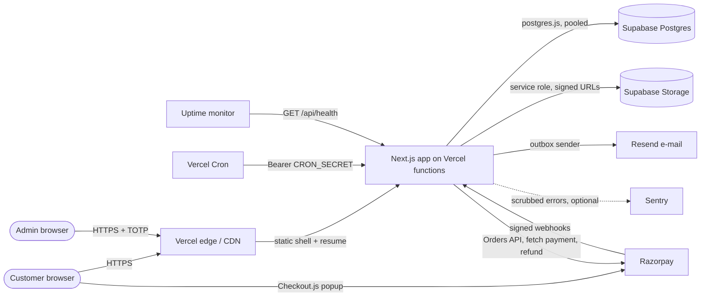
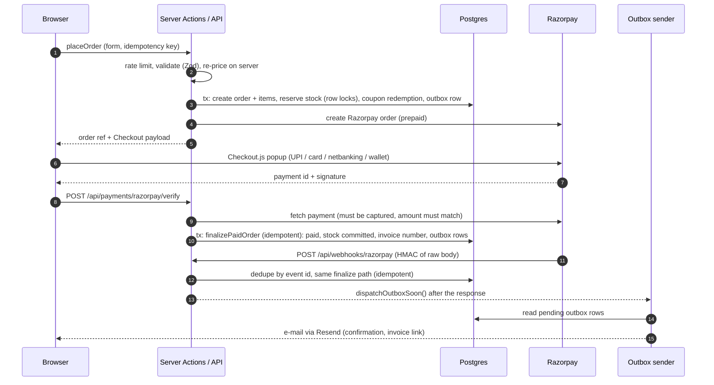

# IfOnli architecture

One Next.js 16 app (App Router, Turbopack, Cache Components, React 19, TypeScript strict) serves the storefront, checkout and admin. Postgres (Supabase) holds all state; Supabase Storage holds files; Razorpay takes payments; Resend sends e-mail; Vercel runs it. Decisions: [DECISIONS.md](./DECISIONS.md). Operations: [RUNBOOK.md](./RUNBOOK.md). The plan: [PLAN.md](./PLAN.md).

## 1. System overview

Principles
- **Server first.** Server Components by default, Server Actions for mutations, Route Handlers only where a URL contract is needed (webhooks, cron, payment verify, invoices, health, CSP/error intake).
- **The database is the source of truth.** No reliance on RLS for the app itself: all access is server-side with the pooled URL as the table owner; the service role key never leaves the server. RLS is nevertheless enabled on every table with no policies, and `anon` / `authenticated` have no privileges, so the Supabase Data API exposes nothing (DECISIONS D-DB-1).
- **Money is integer paise** everywhere (`bigint`), formatted by `src/lib/money.ts`. Prices are tax-inclusive; GST is split on the invoice only.
- **Never trust the client.** Prices, stock, coupons and shipping are recomputed on the server at add-to-cart, quote and place-order.

## 2. Repository map

| Path | Role |
|---|---|
| `src/app/(store)` | Themed storefront: home, shop, vibes, types, products, search, wishlist, help, policies |
| `src/app/(buy)` | Cart, checkout, order page, tracking: palette only (`data-vibe-scope="buy"`), minimal header, no hand button |
| `src/app/admin/(auth)`, `src/app/admin/(app)` | Admin: login and 2FA enrolment (public), then the gated, never-themed back office |
| `src/app/api/*` | `auth/[...all]` (Better Auth), `webhooks/razorpay`, `payments/razorpay/verify`, `orders/[ref]/invoice`, `admin/orders/[id]/invoice`, `cron/*`, `health`, `csp-report`, `monitoring`, `dev/*` (404 in production) |
| `src/proxy.ts` | Coarse `/admin/**` gate (cookie present or redirect to login) plus `noindex` and `no-store` headers. Not used for CSP (see section 8) |
| `src/instrumentation.ts` | `onRequestError` to the error reporter; `register()` loads `instrumentation-node.ts` (production environment check at boot, crash and rejection reporting) in the Node runtime only |
| `src/features/*` | Client-facing feature code: `vibe` (theme engine, hand button, head script), `cart`, `checkout`, `hero`, `search`, `wishlist` |
| `src/components/*` | UI primitives (`ui`), storefront, checkout, admin and content components |
| `src/server/domain` | Pure business rules: pricing, tax, coupons, shipping, order state machine, tokens, signature checks. Fully unit-tested, no I/O |
| `src/server/services` | Use-cases over the database: cart, orders, payments, refunds, invoices, inventory, settings, support, tracking, admin services |
| `src/server/payments` | Provider abstraction (`razorpay`, dev `mock`), verify, webhook, reconcile, cleanup, cron auth |
| `src/server/notify` | Transactional outbox, sender, e-mail channel, templates (`emails/`) |
| `src/server/cache` | `'use cache'` readers, tags, revalidation helpers |
| `src/server/auth` | Better Auth config, roles and permissions, `requireAdmin`, Postgres rate limiter |
| `src/server/security` | `limitByIp`, request helpers, CSP report parsing |
| `src/lib` | Env validation, money, SEO, `security/headers.ts` (CSP), `monitoring/*` (reporter and scrubber) |
| `drizzle/` | SQL migrations (generated by drizzle-kit, committed) |
| `scripts/` | Seeds, admin creation, storage setup, token build, contrast check |
| `tests/` | `unit`, `integration` (real Postgres), `e2e` (Playwright), `visual` |

## 3. Request lifecycle and caching

**Static shell plus dynamic holes (PPR).** Storefront pages are prerendered at build and on revalidation; request-specific parts (live stock, cart count, search params) render in `Suspense` holes that stream in. `RootLayout` reads the cached vibe settings (`cycle`, `default_vibe`) only, so no page becomes dynamic by accident. `pnpm build` prerenders product, vibe and type pages from the database.

**Data cache.** Catalogue and content readers use `'use cache'` with tags (`src/server/cache/tags.ts`):

| Tag | Covers | Invalidated by |
|---|---|---|
| `catalog` | Listings, home sets | Product, variant, vibe and type edits |
| `product:{id}`, `product-slug:{slug}` | One product page, and the old-slug redirect lookup | That product's edits (both its old and new slug on a rename) |
| `collection:vibe:{slug}`, `collection:type:{slug}` | Collection pages | Membership or ordering changes |
| `stock:{productId}` | Stock flags on cards | Orders, reservations, adjustments |
| `content` | Policies, FAQs, site content | Content publish |
| `settings` | Admin settings read by pages | Settings save |

Admin Server Actions call `updateTag` (read-your-writes); Route Handlers (webhook, verify, cron) call `revalidateTag(tag, "max")` (stale-while-revalidate). **Live stock** on the PDP is an uncached hole, and stock is re-validated on the server at add-to-cart and checkout regardless of cache.

**Vibe theme without a flash.** `VibeHeadScript` is a small inline blocking script that resolves `?vibe=` then cookie then `localStorage` then the default and sets `html[data-vibe]` before paint. All four vibes' variants render in the HTML and CSS shows the active one, so switching needs no network round-trip. This is why a nonce CSP is not used (DECISIONS D-SEC-1).

## 4. Auth and RBAC

- **Better Auth** (Drizzle adapter, cookie prefix `ifonli`). Customers: optional passwordless **e-mail OTP** (guest checkout stays the default). Admins (`owner`, `admin`, `fulfilment`): **e-mail + password + TOTP**, mandatory 2FA; guards in `src/server/auth/auth.ts` refuse OTP sign-in for admin roles and password sign-in for customers (D-AUTH-1). Better Auth is reached only through Server Actions; over HTTP `/api/auth/*` serves just `get-session` and `sign-out` (D-SEC-6).
- **Layers on `/admin`**: (1) `proxy.ts` redirects when no session cookie exists; (2) `requireAdmin()` in every admin layout, page and Server Action checks a valid session, an admin role, an enrolled TOTP and the specific permission; (3) the permission matrix lives in `src/server/auth/permissions.ts` (resource to actions per role, unit-tested); (4) mutations write `admin_audit_log`.
- **Rate limits** for sign-in are Postgres-backed (DECISIONS D-SEC-5).
- **Guest order access**: the order page and invoice need `?t=` (random 32-byte token, only its SHA-256 stored, constant-time compare) or a matching e-mail/phone on `/track`. Order and track pages send `Referrer-Policy: no-referrer`.

## 5. Checkout, payment, webhook and outbox

Rules that keep it correct
- **Never mark paid without a verified capture.** Verify and webhook share `finalizePaidOrder`, which is idempotent; a duplicate payment is auto-refunded; a late capture of an expired order is honoured (`expired -> confirmed`) if stock allows, otherwise refunded.
- **Reservations.** Stock is reserved in the same transaction as the order (ordered row locks, no overselling). Availability = on hand minus unexpired reservations. TTL is an admin setting; `release-reservations` frees expired ones after asking Razorpay whether they were paid.
- **Outbox.** Notifications are rows inserted in the state-change transaction; `sender.ts` delivers right after the response and the `notify-retry` cron retries with backoff, so an e-mail can never be lost to a crash nor sent for a rolled-back change.
- **Reconciliation.** `reconcile-payments` repairs missed webhooks and refund statuses.
- **COD** skips the Razorpay legs; the order is `cod_pending` until the admin records collection. In development, with no Razorpay keys, a mock provider and `/api/dev/mock-checkout` stand in for the popup; both refuse to run under `NODE_ENV=production`.

## 6. Data model and storage

Schema is split by area in `src/server/db/schema/` (catalog, orders, inventory, payments, promotions, content, customers, cart, analytics, ops, auth); the entity guide is [DATA-MODEL.md](./DATA-MODEL.md). Notable tables: `variants` (price, stock), `inventory_movements` (ledger; its sum equals `stock_on_hand`), `stock_reservations`, `orders` / `order_items` / `order_events`, `payments`, `refunds`, `webhook_events`, `notification_outbox`, `rate_limits`, `admin_audit_log`.

Storage buckets (Supabase)

| Bucket | Visibility | Content |
|---|---|---|
| `products` | public | Product photos |
| `cutouts` | public | Transparent cutouts used by the hero and cards |
| `content` | public | Site content images |
| `private` | private | Invoices and support-case photos; read only through short-lived signed URLs |

Uploads go through the server (`sharp` re-encodes and strips EXIF); `next/image` reads public buckets via `remotePatterns` derived from `SUPABASE_URL`.

## 7. Analytics and the hero

- **Analytics.** First-party, anonymous events in `analytics_events` (no PII, no payment identifiers, no FKs so history survives deletions) with an hourly rollup into `product_engagement_daily` (Asia/Kolkata day). Metrics: listing impressions (tile at least 50% visible for 1 s, deduped per session) and PDP scroll depth (25/50/75/100). GA4 is optional and only loads after consent when `NEXT_PUBLIC_GA4_ID` is set. Vercel Speed Insights reports Web Vitals. Any public intake endpoint must be rate limited (RUNBOOK section 8).
- **Hero.** A static poster hero is always present (it is the LCP content and the reduced-motion version); the GSAP timeline is a separate lazy chunk layered on top, driven by the active vibe's tokens, with a visible pause control (WCAG 2.2.2). The animation never blocks the Shop button.

## 8. Security architecture

- **Headers** for every route come from `next.config.ts` (built by `src/lib/security/headers.ts`): HSTS (production), `X-Content-Type-Options`, `Referrer-Policy`, `X-Frame-Options`/`frame-ancestors`, `Permissions-Policy`, `Cross-Origin-Opener-Policy: same-origin-allow-popups` (Razorpay popups), and the CSP in `report-only` or `enforce` mode (`CSP_MODE`, build time).
- **Why not a nonce CSP in `proxy.ts`:** a nonce needs dynamic rendering for every page and cannot reach the PPR static shell, which would defeat the caching model (DECISIONS D-SEC-1). The proxy therefore only does the admin gate.
- **Input and abuse:** Zod on every input, Postgres rate limits on every public mutation (RUNBOOK section 8), HMAC on webhooks, constant-time secret compares, honeypot on the contact form, audit log for admin changes.
- **Secrets** only in Vercel env; separate test and live Razorpay keys; the browser sees only the public key id.
- **Errors** are reported with PII scrubbed (`src/lib/monitoring`); the reporter is a no-op without `SENTRY_DSN`.

## 9. Delivery

CI (`.github/workflows/ci.yml`): static checks; integration tests on a `postgres:16` service; functional e2e against `next dev` (the dev payment mock only exists outside production); production build on a migrated and seeded database, then the security/CSP e2e against `next start`, then a second build with dev pages for the vibe timing/font tests, then Lighthouse CI (non-blocking). Vercel deploys `main` (functions in `bom1`, next to the database); Cron jobs are in `vercel.json`. See RUNBOOK sections 2, 3 and 7.
